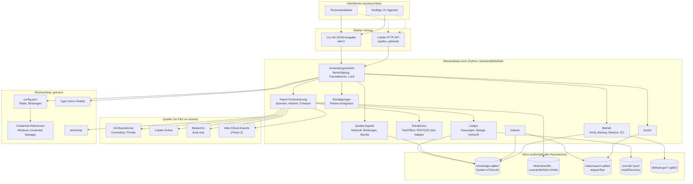

# 02 — Architektur der zentralen Wissensbasis

Stand: 2026-11-05 · Entwurf · Lesender Pilotkern umgesetzt; Profil A ausgeführt; A17/A20 offen.

## 1. Leitprinzipien

1. **Ein Kern, viele Oberflächen.** Der Kern kennt keine Oberfläche. Oberflächen konsumieren den Vertrag `wb/v1` und halten nur flüchtigen Ansichtszustand.
2. **Quellen bleiben, wo sie sind.** Der Kern liest Quellen; er verschiebt sie nicht. Originale sind unveränderlich.
3. **Belege vor Behauptungen.** Jede abgeleitete Aussage verweist auf mindestens eine Belegfassung mit prüfbarer Stelle.
4. **Nichts überschreiben.** Versionen sind unveränderlich; Änderungen erzeugen neue Fassungen, Ablösung ist explizit.
5. **Rechte erben nach unten.** Abgeleitetes Wissen ist höchstens so zugänglich wie seine strengste Quelle.
6. **Bestätigung ist ein Ereignis.** Prüfer, Zeitpunkt und Belegbasis werden festgehalten; neue Belege machen Bestätigungen sichtbar überholt.
7. **Der Index ist wegwerfbar.** Suche ist eine Ableitung aus Register und Text-Blobs, kein Datenspeicher.
8. **Lokal und offline.** Keine Cloud, keine Telemetrie, keine externen Dienste im Kern.
9. **Unbekannt ist ein gültiger Zustand.** Fehlende Erreichbarkeit, fehlende Extraktion oder fehlende Prüfung werden ausdrücklich als `unknown`/`partial`/`unverified` ausgewiesen, nie als Erfolg dargestellt.
10. **Betrieb ist beweisbar.** `verify`, `backup`, `restore` und `index rebuild` sind normale, getestete Befehle.

## 2. Systemgrenzen und Betriebsmodell

- **Genau ein führender Store.** Der Leader-Store ist ein lokales Verzeichnis außerhalb aller Git-Repositories, außerhalb von OneDrive/Netzwerkfreigaben und außerhalb von `%TEMP%`. Nur er ist beschreibbar.
- **Zweitrechner lesen nur.** Ein zweiter Rechner erhält ein eingefrorenes Read-only-Paket, das lokal wiederhergestellt wird. Es gibt keinen Live-Sync und keine aktive SQLite-Datenbank in OneDrive.
- **Ein schreibender Prozess.** Parallele Schreiber sind über eine Lock-Datei ausgeschlossen. Lesen ist auch während eines Imports möglich, aber nur über den Kern (nicht über direkte DB-Verbindungen von Clients).
- **Kein Dienstzwang.** Der Kern ist eine CLI. Eine lokale HTTP-API ist eine spätere, optionale Hülle über derselben Anwendungsschicht.
- **Keine Oberfläche besitzt Daten.** Die Themenlandkarte und künftige Clients dürfen weder die SQLite-Datei öffnen noch Blob-Pfade erraten.
- **Rechnerbindung getrennt.** Pfade und Zugangsdaten liegen in der lokalen Konfiguration (`%LOCALAPPDATA%\AI-OS\Wissensbasis`), nicht im Store. Der Store bleibt kopier-/sicherbar, ohne rechnerabhängige Geheimnisse zu enthalten.

### 2.1 Führender Store und lesender Austausch

```
Hauptrechner (leader)                         Zweitrechner (mirror)
C:\AI-OS-Wissensbasis                         C:\AI-OS-Wissensbasis-ReadOnly
  db/  blobs/  index/  journal/                 entpacktes Paket (Manifest role=mirror)
        │                                              ▲
        └── wb package create ──► Paket (inert) ───────┘
                                  USB/OneDrive-Archiv
                                  keine offene DB
```

- `wb package create` erzeugt einen konsistenten Datenbank-Snapshot, die Text-Blobs, das Journal, ein Manifest mit Hashes und einen Rechte-Snapshot. Es enthält **keine** lokalen Pfade und keine Zugangsdaten.
- `wb restore --readonly` spielt das Paket lokal ein. Der Spiegel verweigert Import, Quellenänderung, Notizen, Bestätigungen und Originalabruf; Suche und Lesen funktionieren.
- Aktualisierung nur durch ein neues Paket. Das Paket darf in OneDrive liegen, solange es nicht als Datenbank geöffnet wird („keine aktive SQLite über OneDrive“).

## 3. Architekturdiagramm



Lesbare Kurzform ohne Diagrammwerkzeug:

```
Oberflächen (Landkarte, künftige UI, Agenten)
        │  Vertrag wb/v1 (JSON)
        ▼
Anwendungsschicht  ──►  Quellenregister, Import, Extraktion,
        │              Ledger, Reviews, Suche, Betrieb
        │
        ├──► Store:  knowledge.sqlite3   (Wahrheit)
        │            blobs/sha256/…      (Belege, unveränderlich)
        │            index/search.sqlite3 (ableitbar, löschbar)
        │            journal/*.jsonl     (Audit)
        │            db/backups/…        (Sicherung)
        │
        └──► Quellen (nur lesend): Repos, Ordner, Mailarchiv, Exporte
```

## 4. Komponenten und Verantwortlichkeiten

| Komponente | Verantwortung | Darf nicht |
| --- | --- | --- |
| Anwendungsschicht | Befehle ausführen, Rechte prüfen, Transaktionen, Locking, Fehler in Vertragsfehler übersetzen | Fachliche Sonderfälle einzelner Oberflächen kennen |
| Quellenregister | Quellen, Herkunft, Bindungen, Rechte, Erreichbarkeit, **beobachteter Dateizugriff**, Aufbewahrung | Dateien als „Wahrheit“ ohne Version führen |
| Zugriffsprüfung | Konfiguriertes Recht, tatsächlicher Zugriff (`os.access`), Klassifikation und Ableitungs-Schnittmenge prüfen | `mixed` als Leseerlaubnis behandeln |
| Import-Orchestrierung | Scannen, Hashen, Erfassen, Extrahieren, Commit, Wiederaufnahme | Originale verändern oder Quellen in den Store verschieben |
| Extraktoren | Text und Struktur mit Status (`full`/`partial`/`failed`/`unsupported`) liefern, Extraktorversion melden; PDF/OCR über eine isolierte, versionierte Laufzeit (`%LOCALAPPDATA%\AI-OS\Wissensbasis\runtime`), Office über XML im Kern | Vollständigkeit behaupten, Modelle aufrufen, Fremdpakete in den Kern zwingen |
| Ledger | Elemente, Fassungen, Belege, Herkunftskanten, Reviews, Rechte, Ereignisse | Fassungen ändern oder löschen |
| Bestätigungen | Review-Ereignisse, Gültigkeit, Überholung | Bestätigungen automatisch auf neue Fassungen übertragen |
| Indexer | Text in Abschnitte zerlegen und FTS5 bauen, Build-ID und Quelle festhalten | Metadaten als Wahrheit führen |
| Suche | Belegte Treffer mit Quelle, Element, Fassung, Stelle | Treffer ohne Beleg oder mit erfundenen Auszügen liefern |
| Betrieb | `verify`, `backup`, `restore`, `gc`, `acl recheck`, Status | Originale oder Rechte stillschweigend ändern |
| Vertragsschicht | Stabile JSON-Antworten, Fehlercodes, Versionierung | Datenbankdetails oder Blob-Pfade als API anbieten |

## 5. Datenflüsse

### Lesen

```
Client → wb/v1 → Anwendungsschicht → Quellenregister/Ledger → Antwort mit
  - Quelle, Element, Fassung, Hash, Erfassungszeit
  - Extraktionsstatus und -grund
  - Belegstellen auf Anfrage
```

### Import

```
Quelle → Scan → Hash → [bekannt? → Beobachtung] → Blob schreiben → Extraktion
       → Ledger-Transaktion (Element, Fassung, Belege) → Journal → Bericht
```

### Aktualisieren

```
Scan → neuer Hash → neue Fassung → abhängige Ableitungen markieren
     → Bestätigungen als überholt markieren → Index inkrementell ergänzen
```

### Suchen und Wiederherstellen

```
Ledger + Text-Blobs → Indexer → index/search.sqlite3 (Build-ID)
                                   ↑ jederzeit löschbar und neu baubar
Client → wb/v1 search → Treffer mit Belegkanten
```

## 6. Vertrag `wb/v1`

Einheitliche Hülle für alle Befehle (CLI mit `--json`, später HTTP):

```json
{
  "schema": "wb/v1",
  "ok": true,
  "data": {},
  "warnings": [],
  "error": null,
  "meta": { "tool_version": "0.1.0", "schema_version": 1, "store_id": "wb-…" }
}
```

- **IDs** sind opak und stabil; Clients dürfen sie nicht interpretieren.
- **Zeitangaben** sind UTC im Format `YYYY-MM-DDTHH:MM:SS.ffffffZ`; Anzeigezeit ist Sache der Oberfläche.
- **Unbekannt** wird als `null` plus `state: "unknown"|"partial"|"failed"|"unverified"` und `reason` geliefert, nie als leerer Erfolg.
- **Fehler** haben `code`, `message`, `recoverable`; Exit-Codes: 0 Erfolg, 2 Eingabefehler, 3 Rechtefehler, 4 Quellenfehler, 5 Integritätsfehler, 6 Konflikt.
- **Pagination** mit `limit`/`cursor`, deterministische Sortierung.
- **Keine Inhalte in Logs**; Fehlermeldungen nennen Pfade nur relativ zur Quelle, sofern möglich.
- **Kompatibilität:** `schema_version` wird erhöht, wenn sich Felder ändern; alte Clients erhalten mindestens eine Minor-Version lang weiterhin ihre Felder. Migrationen sind nummeriert und rückwärts geprüft.

## 7. Technologieentscheidungen

| Entscheidung | Begründung | Verworfene Alternative |
| --- | --- | --- |
| Python 3.10+, Kern nur Standardbibliothek; Extraktoren optional über isolierte Laufzeit | Auf dem Rechner vorhanden; Kern ohne Abhängigkeiten; PDF/OCR brauchen Fremdpakete und laufen getrennt; Office wird über XML im Kern gelesen | Node/TypeScript-Kern (kein SQLite ohne Paket), PowerShell-Kern (kein robustes SQLite), Fremdpakete direkt im Kern |
| SQLite mit WAL als Register | Transaktionen, Integrität, bewährt im Mail-Import; FTS5 integriert | Dateien pro Entität (langsam, fehleranfällig), externe DB (Installation) |
| Eigener FTS5-Index in separater DB | Löschbar und neu baubar, ohne das Register zu gefährden | Index im Register (ein Fehler trifft alles) |
| Inhaltsadressierte Blobs | Dedupe, Prüfbarkeit, unveränderliche Belege | Dateisystem als Wahrheit (Umbenennen/Löschen zerstört Belege) |
| Markdown als Ableitungsformat | Lesbar, diffbar, portabel; passt zu bestehenden Konventionen | Proprietäres Format, Datenbank-only |
| Lexikalische Suche (FTS5/BM25) | Nachvollziehbar, offline, keine Modellabhängigkeit | Embeddings/Vektordatenbank (Betriebsaufwand, Intransparenz) |
| Keine automatische KI-Ableitung im Pilot | Vertrauen und Belegpflicht zuerst | RAG-Sofortbetrieb (unbestätigte Inhalte) |
| Lokale CLI plus optionale HTTP-Hülle | Einfacher Betrieb, testbar, oberflächenunabhängig | Server-Zwang, Cloud-Dienst |

Die im Mail-Import bewährten Muster (Hash-Identität, atomare Schreibvorgänge, Stapeltransaktionen, Belegprüfung) werden übernommen; der Mail-Import selbst wird erst in Phase 3 als **Adapter** angebunden.

## 8. Trennung von Inhalt, Code, Werkzeug und Temporaerdateien

| Kategorie | Ort | Erlaubt | Verboten |
| --- | --- | --- | --- |
| Originale | in ihren Quellen (Repos, Ordner, Archive) | unverändert lesen, separat sichern | kopieren in den Store als Ersatz, verschieben, überschreiben |
| Ledger und extrahierter Text | Store-Root, außerhalb Repos | unveränderliche Fassungen, Text-Blobs, Metadaten | Im Git-Repository, in OneDrive, in `%TEMP%` |
| Code und Werkzeuge | `shared/tools/wissensbasis/` (Repo) | Quellcode, Tests, Schema-Migrationen, Dokumentation | Datenbanken, Blobs, Logs, Exporte |
| Entwurfsdokumente | `shared/wissensbasis/` (Repo) | Architektur, Datenmodell, Pilot | Wissensinhalte, Quelltexte, personenbezogene Daten |
| Rechnerkonfiguration | `%LOCALAPPDATA%\AI-OS\Wissensbasis\config.json` | Pfade, Bindungen, Präferenzen | Geheimnisse im Klartext |
| Extraktor-Laufzeit | `%LOCALAPPDATA%\AI-OS\Wissensbasis\runtime` (oder vorhandene Themenlandkarten-Laufzeit) | Gepinnte Fremdpakete, isolierte Ausführung, Revision | Im Store, im Repository, unversioniert oder ungeprüft |
| Zugangsdaten | Windows Credential Manager | Referenzen (`credential_ref`) | Secrets in Store, Repo, Logs |
| Temporaerdateien | `store/tmp/` | Kurzlebige Arbeitsdateien, die nach Erfolg/Fehler gelöscht werden | Dauerhafte Ablage, Indexierung |
| Logs | `%LOCALAPPDATA%\AI-OS\Wissensbasis\logs\` | Ereignisse ohne Inhalte | Dokumenttexte, Empfängerlisten, Tokens |
| Sicherungen | externes Ziel über `wb backup --out` | Konsistente DB-, Text- und Journal-Sicherung mit Prüfsummen | Sicherungen im Store, in Repositories oder unverschlüsselt offsite |

### 8.1 Datenklassen und Sicherungspriorität

| Klasse | Inhalt | Reproduzierbar? | Sicherung |
| --- | --- | --- | --- |
| A | Originale (in den Quellen) | nein | separat und unabhängig, siehe [06_SICHERUNG.md](06_SICHERUNG.md) |
| B | Ledger: Herkunft, Fassungen, Notizen, Bestätigungen, Rechte, Ereignisse | nein | `wb backup` (DB) |
| C | Extrahierter Text (`blobs/`) | im Prinzip aus Original + Extraktor | `wb backup` (Text-Blobs) |
| D | FTS-Index (`index/`) | ja | nicht sichern; `wb index rebuild` |
| E | Exporte/Pakete | ja | bei Bedarf neu erzeugen |
| F | Rechnerkonfiguration | nein, aber ersetzbar | separat, ohne Geheimnisse |

Der Store selbst enthält **keine** ausführbaren Programme und keine Konfiguration. `wb init` bricht ab, wenn der Zielpfad in einem Git-Repository, in `%TEMP%` oder in einem erkannten Cloud-Sync-Ordner liegt.

## 9. Nicht-funktionale Anforderungen

| Bereich | Vorgabe (Pilot) |
| --- | --- |
| Dauerhaftigkeit | WAL, `synchronous=FULL`; jede Importeinheit in einer Transaktion; Blob vor DB-Commit, `fsync`; Absturz erzeugt höchstens verwaiste Blobs, keine halben Fassungen |
| Datenintegrität | `PRAGMA integrity_check` + `foreign_key_check` bei jeder Sicherung; `wb verify` prüft jede Blob-Prüfsumme und jede Belegstelle |
| Wiederherstellung | Täglicher konsistenter Snapshot (im Pilot manuell); RPO 24 h, RTO 1 h; Index-Rebuild ≤ 60 s im Pilot |
| Leistung | Import ≤ 5 min für ≤ 150 Elemente/≤ 250 MB; Suche p95 ≤ 300 ms; `verify` ≤ 60 s; siehe Pilot |
| Datenschutz | Nur lokal; keine Telemetrie; Logs ohne Inhalte; Rechteprüfung vor jeder Ausgabe; Export nur gefiltert |
| Portabilität | Export als JSONL + Blobs + Manifest; Wiederherstellung auf einem anderen Rechner möglich, ohne Pfade zu übernehmen |
| Wartbarkeit | Kern nur Standardbibliothek; Extraktoren isoliert und gepinnt; klar getrennte Module, versionierte Migrationen, Tests ohne echte Daten |
| Bedienbarkeit | Jeder Befehl hat `--dry-run` oder eine Vorschau; jeder Fehler nennt den nächsten Schritt |
| Nachvollziehbarkeit | Jede Änderung erzeugt ein Journal-Ereignis mit Akteur, Zeit, Entität |

## 10. Fehlermodell

| Situation | Verhalten | Sichtbarer Zustand |
| --- | --- | --- |
| Abbruch während Import | Transaktion je Element; Blob bleibt ggf. verwaist | Element `pending`, Wiederholung ergänzt; `gc` räumt |
| Quelle nicht erreichbar | Kein Fehlschlag des gesamten Laufs; Elemente bleiben auf letztem Stand | Quelle `unreachable`, letzter Erfolg unverändert, Grund genannt |
| Datei nicht lesbar/verschlüsselt | Element wird erfasst, Extraktion `failed` mit Grund | Keine Vortäuschung von Text |
| Blob beschädigt | `verify` meldet Hash-Abweichung; Element wird gesperrt | `integrity_error`, keine Ausgabe als geprüft |
| DB beschädigt | Wiederherstellung aus Snapshot; Journal dient der Nachvollziehbarkeit | Store `recovering` |
| Index beschädigt/fehlt | Index löschen und neu bauen | Suche vorübergehend `unavailable`, keine falschen Treffer |
| Zwei Schreiber | Lock verhindert zweiten Schreiber | `locked`, klare Meldung |
| Speicher voll | Lauf bricht sauber ab, keine halbe Fassung | `disk_full`, Wiederholung nach Freigabe |
| Rechte geändert | `acl recheck` markiert betroffene Ableitungen | `restricted`/`needs_review` |

## 11. Ausdrückliche Nicht-Ziele

- Keine Zusammenführung der Repositories, keine neue Git-Wurzel für die Organisationen.
- Keine Verschiebung oder Umbenennung von Originalen.
- Kein automatisches Zurückschreiben in Quellen.
- Keine Oberflächenentwicklung (Themenlandkarte bleibt eingefroren).
- Keine Cloud-Synchronisation, kein Mehrbenutzerbetrieb, keine Netzwerkfreigabe des Stores.
- Keine Embeddings, keine semantische Suche, keine automatischen Zusammenfassungen und keine Wissensverdichtung (Claims, Entscheidungen) im Pilot. Diese Funktionen sind ausdrücklich **später und offen**.
- Keine Migration der 12 600 Bestandsdateien, keine Befüllung der `04_KNOWLEDGE`-Struktur.

## 12. Umsetzungsphasen

| Phase | Inhalt | Ergebnis |
| --- | --- | --- |
| P0 | Diese Unterlagen prüfen, O1–O5, O9, O10 entscheiden | Freigabe |
| P1 | Kern-Skelett: Schema, Blob-Store, CLI `init/source/import/verify/index`, synthetische Tests | **umgesetzt** (16 Tests bestanden) |
| P2 | Pilotimport gemäß [05_PILOTIMPORT.md](05_PILOTIMPORT.md): Profil A verpflichtend, Profil B (PDF) optional | **Profil A ausgeführt**; PDF/OCR an zwei PDFs geprüft; Profil B (50 PDFs) offen |
| P3 | Mail-Adapter (bestehender Import als Quelle), Anhänge als eigene Elemente | Erweiterte Abdeckung |
| P4 | Lokale HTTP-API, Anbindung einer Oberfläche (z. B. Quellenansicht) | Oberflächenunabhängigkeit belegt |
| P5 | Exportpakete und Wiederherstellung auf zweitem Rechner | **Read-only-Paket umgesetzt**, Zweitrechner-Test offen |
| P6 | Entscheidung über Schreibkanal W2, Verschlüsselung, Aufbewahrung | Nur bei Bedarf |

Semantische Suche und Wissensverdichtung sind **nicht** Teil dieser Phasen; sie benötigen einen eigenen Auftrag, ein Qualitätskonzept und eine Belegprüfung.

Der Pilot ist die Entscheidungsgrundlage; ohne bestandene Abnahmekriterien wird nicht in den Dauerbetrieb übergegangen.
