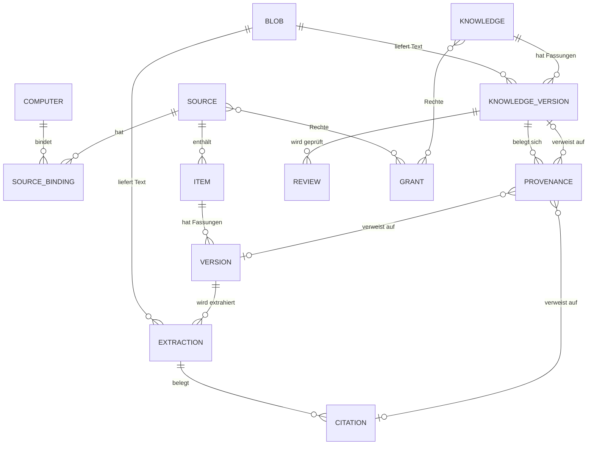
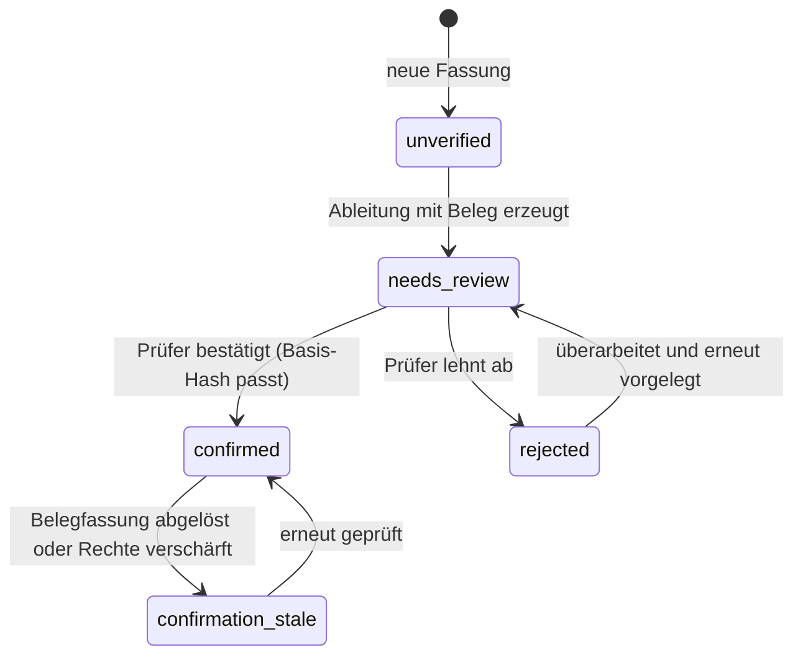

# 03 — Datenmodell

Stand: 2026-11-05 · Entwurf · Datenmodell; lesender Pilotkern umgesetzt.

## 1. Konventionen

- **IDs** sind opak. Deterministische IDs werden nur dort verwendet, wo Idempotenz sie verlangt (Quellen, Elemente, Fassungen). Wissen erhält Zufalls-IDs, damit Titeländerungen keine Identität verschieben.
- **Zeit** ist UTC (`YYYY-MM-DDTHH:MM:SS.ffffffZ`). Anzeigezeitzone ist Sache der Oberfläche.
- **Unbekannt** ist `null` mit `state` und `reason`; es gibt keinen Ersatzwert wie `0`, `""` oder „ok“.
- **Unveränderlichkeit:** Zeilen in `blob`, `version`, `extraction`, `citation`, `knowledge_version`, `provenance`, `review`, `event` werden nie inhaltlich geändert. Korrekturen sind neue Zeilen; Statuswechsel erzeugen Ereignisse.
- **Löschen** ist ein Tombstone (`removed_at`, `archived_at`, `retracted`), kein physisches Löschen. `purge` ist ein eigener, protokollierter Vorgang.
- **Enums** sind klein geschrieben und stabil; deutsche Anzeigetexte liegen in der Oberfläche.
- **Herkunft** wird als JSON an der Quelle geführt, damit neue Quellentypen ohne Schemaänderung beschrieben werden können; die ausgewerteten Felder sind im Vertrag dokumentiert.
- **Deutsche Bestandswerte** werden abgebildet: `privat` → Raum `private`, `vertraulich` → `confidential`, `intern` → `internal`; die Originalbezeichnung bleibt in `origin_json.vocabulary` erhalten.

## 2. Entitätenübersicht (ER)



## 3. Tabellen

### 3.1 `meta`

| Spalte | Typ | Regel |
| --- | --- | --- |
| `key` | TEXT PK | `schema_version`, `store_id`, `created_at`, `extractor_policy`, `confidentiality_policy` |
| `value` | TEXT | UTF-8, validiert beim Lesen |

### 3.2 `computer`

| Spalte | Typ | Regel |
| --- | --- | --- |
| `id` | TEXT PK | `pc-<uuid>`; einmalig bei `init` erzeugt |
| `name` | TEXT | Computername |
| `os_user` | TEXT | Benutzerkonto (kein Passwort) |
| `first_seen_at` / `last_seen_at` | TEXT | UTC |

### 3.3 `source`

| Spalte | Typ | Regel |
| --- | --- | --- |
| `id` | TEXT PK | `src-…`, vom Menschen vergeben, unveränderlich; nur Anzeigename änderbar |
| `kind` | TEXT | `git_repo`, `folder`, `mail_archive`, `web`, `cloud_export`, `curated` |
| `space` | TEXT | `business` oder `private` |
| `confidentiality` | TEXT | `public`, `internal`, `confidential`, `restricted` |
| `canonical` | INTEGER | 1 = führende Quelle (Repository-Dokumente), 0 = Beleg-/Rohquelle |
| `origin_json` | TEXT | Herkunft: Organisation, Eigentümer, Erwerbsart, Nutzungsrecht, Freigabedatum, Vokabular |
| `retention` | TEXT | `keep`, `keep_10y`, `review_after:<ISO-Datum>`, `purge_allowed` |
| `status` | TEXT | `active`, `paused`, `retired` |
| `created_at` / `updated_at` | TEXT | UTC |

`origin_json` (Beispiel):

```json
{
  "organisation": "AI-Consulting-OS",
  "owner": "Patrik",
  "acquisition": "lokaler Ordner, aus bestehendem Engagement",
  "usage_rights": "interne Beratungsarbeit, nicht öffentlich",
  "authorization": "Nutzerauftrag 2026-11-05, nur lesend",
  "vocabulary": { "confidentiality": "vertraulich", "space": "Geschäft" }
}
```

### 3.4 `source_binding`

| Spalte | Typ | Regel |
| --- | --- | --- |
| `id` | TEXT PK | `bnd-<uuid>` |
| `source_id` | TEXT FK | `source.id` |
| `computer_id` | TEXT FK | `computer.id` |
| `binding_key` | TEXT | Verweis auf den Eintrag in der lokalen `config.json`; die Locator-Angabe selbst liegt **nicht** im Store |
| `kind` | TEXT | `local_path`, `unc_path`, `remote`, `credential_ref` |
| `locator_fingerprint` | TEXT | SHA-256 über den lokalen Locator; erkennt Konfigurations-/Store-Abweichungen, ohne den Pfad zu speichern |
| `credential_ref` | TEXT NULL | Verweisname auf Windows Credential Manager, kein Wert |
| `read` / `write` / `derive` | INTEGER | 0/1; effektives Recht = Quelle ∧ Bindung |
| `state` | TEXT | `reachable`, `unreachable`, `unknown`, `partial`, `access_denied` |
| `last_check_at` | TEXT | jede Prüfung |
| `last_success_at` | TEXT NULL | letzter erfolgreicher Import |
| `last_error` | TEXT NULL | ohne Inhalte, mit Grund |
| `observed_read` / `observed_write` | INTEGER NULL | tatsächlicher Zugriff des laufenden Benutzers (`os.access`), `NULL` = unbekannt |
| `access_method` | TEXT NULL | z. B. `os_access` |
| `access_checked_at` | TEXT NULL | Zeitpunkt der letzten tatsächlichen Prüfung |
| UNIQUE | (`source_id`, `computer_id`) | eine Bindung je Rechner |

Der absolute Pfad ist rechnerbezogen und steht ausschließlich in `%LOCALAPPDATA%\AI-OS\Wissensbasis\config.json`. Für die Herkunft genügt der portable `origin_json.origin_ref` (repository-relativer Pfad oder URL).

### 3.5 `item`

| Spalte | Typ | Regel |
| --- | --- | --- |
| `id` | TEXT PK | `itm-<sha256(source_id \| normalized_external_id)[:24]>` |
| `source_id` | TEXT FK | |
| `external_id` | TEXT | normalisierter Pfad/Message-ID/URL; `\` → `/`, Kleinschreibung bei case-insensitiven Quellen |
| `display_path` | TEXT | Originalschreibweise, rein zur Anzeige |
| `kind` | TEXT | `document`, `mail`, `attachment`, `web_page`, `curated_doc` |
| `media_type` | TEXT NULL | z. B. `application/pdf` |
| `register_id` | TEXT NULL | bestehende fachliche ID (`DRV-001`, `SRC-01`, `U-01`) |
| `register_ref` | TEXT NULL | Pfad relative zur Quellwurzel |
| `canonical` | INTEGER | 1 = führende Fassung im Repository |
| `first_seen_at` / `last_seen_at` | TEXT | UTC |
| `removed_at` | TEXT NULL | Tombstone |
| UNIQUE | (`source_id`, `external_id`) | Identität je Quelle |

### 3.6 `blob` (extrahierter Text)

| Spalte | Typ | Regel |
| --- | --- | --- |
| `hash` | TEXT PK | SHA-256 über die Blobbytes |
| `rel` | TEXT | `sha256/ab/cd/<hash>` (relativ zu `blobs/`) |
| `size` | INTEGER | |
| `media_type` | TEXT | im Pilot `text/plain` oder `text/markdown` |
| `created_at` | TEXT | |

**Im lesenden Pilotkern werden keine Originalbytes gespeichert.** Ein Blob ist ausschließlich extrahierter Text. Originalbytes bleiben in der Quelle; ihre Identität ist der SHA-256 in `version.content_hash`. Der Originalabruf liest die Quelle, prüft den Hash und kopiert erst dann. Ein optionaler Original-Snapshot ist als spätere Entscheidung (O2) vorgesehen; dafür wäre ein zusätzlicher Blob-Typ nötig.

Blobs sind unveränderlich. Schreibvorgang: temporäre Datei im Store-`tmp/`, `fsync`, atomarer Rename, Hash prüfen, dann DB-Eintrag.

### 3.6.1 `access_check` (Zugriffsnachweis)

| Spalte | Typ | Regel |
| --- | --- | --- |
| `id` | TEXT PK | `acc-<uuid>` |
| `scope_type` / `scope_id` | TEXT | `source_binding` oder `source` |
| `computer_id` | TEXT | Rechner, auf dem geprüft wurde |
| `observed_read` / `observed_write` | INTEGER | Ergebnis von `os.access` |
| `method` | TEXT | `os_access`; künftig auch externe Attestierung |
| `checked_at` | TEXT | UTC |
| `detail` | TEXT NULL | Grund bei Verweigerung |

Jede Prüfung wird festgehalten, nicht nur der letzte Zustand. So bleibt nachvollziehbar, wann ein tatsächlicher Zugriff bestand.

### 3.7 `version`

| Spalte | Typ | Regel |
| --- | --- | --- |
| `id` | TEXT PK | `ver-<sha256(item_id \| content_hash)[:24]>` |
| `item_id` | TEXT FK | |
| `content_hash` | TEXT | SHA-256 der **Originalbytes**; kein FK, weil Originalbytes nicht im Store liegen |
| `size` / `media_type` | INTEGER / TEXT | Größe und Typ der Originaldatei |
| `original_stored` | INTEGER | im Pilot immer `0`; `1` nur bei späterem Original-Snapshot |
| `seq_no` | INTEGER | 1..n je Element |
| `first_observed_at` / `last_observed_at` | TEXT | UTC |
| `source_mtime` | TEXT NULL | aus der Quelle, unverändert |
| `supersedes_version_id` | TEXT NULL FK | Vorgänger |
| UNIQUE | (`item_id`, `content_hash`) | identischer Inhalt erzeugt keine neue Fassung |
| UNIQUE | (`item_id`, `seq_no`) | lückenlos, nur innerhalb einer Transaktion |

### 3.8 `extraction`

| Spalte | Typ | Regel |
| --- | --- | --- |
| `id` | TEXT PK | `ext-<uuid>` |
| `version_id` | TEXT FK | |
| `extractor` | TEXT | z. B. `markdown`, `pdf-text`, `pdf-ocr`, `docx`, `eml` |
| `extractor_version` | TEXT | Werkzeug-/Regelversion |
| `status` | TEXT | `full`, `partial`, `failed`, `unsupported`, `pending` |
| `reason` | TEXT NULL | Pflicht bei nicht-`full` |
| `text_hash` | TEXT NULL FK → `blob.hash` | extrahierter Text als Blob |
| `created_at` | TEXT | |
| `is_current` | INTEGER | genau eine je Fassung und Extraktor |
| `pages_json` | TEXT NULL | PDF-Seitenmetadaten: Liste `{page,start,end,chars,ocr}`; `start`/`end` sind Zeichenoffsets im extrahierten Text |

Extraktionsstatus wird nie „aufgefüllt“. Ein fehlender Text bleibt `failed`/`unsupported` mit Grund, auch wenn Metadaten vorhanden sind. Ein OCR-Lauf ersetzt die aktuelle Extraktion durch eine neue Zeile (`extractor=pdf-ocr`); die alte Zeile bleibt mit `is_current=0` erhalten. Seiten mit `chars` unter 40 und ohne `ocr=true` gelten als ausstehend.

### 3.9 `citation`

| Spalte | Typ | Regel |
| --- | --- | --- |
| `id` | TEXT PK | `cit-<uuid>` |
| `extraction_id` | TEXT FK | |
| `kind` | TEXT | `page`, `char`, `line`, `cell`, `mail_part`, `url` |
| `locator_json` | TEXT | z. B. `{"page":3}`, `{"start":1200,"end":1240}`, `{"sheet":"Budget","cell":"B7"}` |
| `quote` | TEXT | wörtlicher Text aus der Extraktion |
| `quote_hash` | TEXT | SHA-256 des Zitats |
| `verified_at` | TEXT NULL | Zeitpunkt der Prüfung gegen den Text |
| `verified` | INTEGER | 1 nur nach erfolgreicher Prüfung |

Persistierte Belegstellen entstehen erst mit abgeleitetem Wissen (später). Die Volltextsuche des Pilotkerns liefert berechnete Zeichenstellen, die sie gegen den gespeicherten Text prüft; sie werden nicht als `citation` gespeichert.

### 3.10 `knowledge`

| Spalte | Typ | Regel |
| --- | --- | --- |
| `id` | TEXT PK | `knw-<uuid>` |
| `kind` | TEXT | `note`, `summary`, `claim`, `decision`, `topic`, `entity`, `register_entry` |
| `title` | TEXT | ≤ 300 Zeichen |
| `space` | TEXT | `business`, `private`, `mixed` — berechnet aus Belegen |
| `confidentiality` | TEXT | Maximum der Belege |
| `canonical` | INTEGER | 1 = kanonisch im Store (Notizen) |
| `created_by` / `created_at` | TEXT | |
| `current_version_id` | TEXT NULL FK | |
| `archived_at` | TEXT NULL | |

### 3.11 `knowledge_version`

| Spalte | Typ | Regel |
| --- | --- | --- |
| `id` | TEXT PK | `knv-<uuid>` |
| `knowledge_id` | TEXT FK | |
| `version_no` | INTEGER | 1..n |
| `content_hash` | TEXT FK → `blob.hash` | Markdown-Body (UTF-8) |
| `author` | TEXT | |
| `created_at` | TEXT | |
| `lifecycle` | TEXT | `draft`, `active`, `deprecated`, `retracted` |
| `review_state` | TEXT | `unverified`, `needs_review`, `confirmed`, `rejected`, `confirmation_stale` |
| `basis_json` | TEXT | eingefrorene Belegbasis: Liste `{type,id,hash,extraction_id}` |
| `effective_space` / `effective_confidentiality` | TEXT | bei Erstellung berechnet, bei `acl recheck` neu berechnet |
| `published_ref` | TEXT NULL | Pfad/Kennung der Veröffentlichung in einem Repository |
| `supersedes_version_id` | TEXT NULL FK | |
| UNIQUE | (`knowledge_id`, `version_no`) | |

### 3.12 `provenance`

| Spalte | Typ | Regel |
| --- | --- | --- |
| `id` | TEXT PK | `prv-<uuid>` |
| `knowledge_version_id` | TEXT FK | |
| `relation` | TEXT | `derived_from`, `supports`, `contradicts`, `cites`, `supersedes` |
| `evidence_version_id` | TEXT NULL FK | |
| `evidence_citation_id` | TEXT NULL FK | |
| `target_knowledge_version_id` | TEXT NULL FK | |
| `note` | TEXT NULL | warum diese Beziehung besteht |
| `created_at` | TEXT | |
| CHECK | genau eines der drei Ziele gesetzt | |

### 3.13 `review`

| Spalte | Typ | Regel |
| --- | --- | --- |
| `id` | TEXT PK | `rev-<uuid>` |
| `knowledge_version_id` | TEXT FK | |
| `reviewer` | TEXT | Principal |
| `decision` | TEXT | `confirmed`, `rejected`, `needs_review` |
| `note` | TEXT NULL | |
| `decided_at` | TEXT | |
| `basis_hash` | TEXT | Hash über `basis_json`; schützt vor Bestätigung einer veränderten Basis |
| `basis_json` | TEXT | Kopie der geprüften Belegbasis |
| `invalidated_by_version_id` | TEXT NULL FK | Belegfassung, die die Bestätigung überholt hat |
| `invalidated_at` | TEXT NULL | |
| `invalidated_reason` | TEXT NULL | |

### 3.14 `grant`

| Spalte | Typ | Regel |
| --- | --- | --- |
| `id` | TEXT PK | `grt-<uuid>` |
| `subject_type` | TEXT | `user`, `role`, `machine` |
| `subject_id` | TEXT | z. B. SID, Rollenname, `pc-…` |
| `scope_type` | TEXT | `store`, `space`, `source`, `knowledge` |
| `scope_id` | TEXT | |
| `actions` | TEXT | JSON-Array aus `read`, `derive`, `derive_cross_space`, `write`, `review`, `export`, `admin` |
| `granted_by` / `granted_at` | TEXT | |
| `expires_at` | TEXT NULL | |
| `note` | TEXT NULL | |

### 3.15 `event` und `journal`

| Spalte | Typ | Regel |
| --- | --- | --- |
| `seq` | INTEGER PK AUTOINCREMENT | lückenlos je Store |
| `id` | TEXT UNIQUE | `evt-<uuid>` |
| `at` | TEXT | UTC |
| `type` | TEXT | `source.added`, `import.completed`, `version.created`, `review.confirmed`, `acl.recheck`, `index.rebuilt`, `job.failed`, … |
| `entity_type` / `entity_id` | TEXT | |
| `actor` | TEXT | Principal |
| `computer_id` | TEXT | |
| `payload_json` | TEXT | ohne Inhalte; Hash/IDs/Status |

Zusätzlich wird jede Zeile als JSONL in `journal/events-YYYY-MM.jsonl` gespiegelt (append-only). Das Journal dient Audit und Notfall-Nachvollziehbarkeit, ersetzt aber kein DB-Backup.

### 3.16 `job`, `run`, `schema_migrations`

- `job`: `id`, `kind` (`import`, `reindex`, `verify`, `backup`), `state`, Zeiten, `error`, `stats_json`.
- `run`: Importlauf mit Zählern `scanned`, `new_items`, `new_versions`, `unchanged`, `failed`, `skipped`, `elapsed`.
- `schema_migrations`: `version`, `applied_at`, `checksum`; ein Store startet niemals mit unbekannter höherer Version.

## 4. Identität und Versionierung

| Regel | Inhalt |
| --- | --- |
| R1 | Eine Quellen-ID ist unveränderlich. Umbenennen ändert nur den Anzeigenamen. |
| R2 | Eine Quelle hat je Rechner genau eine Bindung. Rechte sind die Schnittmenge aus Quelle und Bindung. |
| R3 | Element-Identität folgt der `identity_strategy` der Quelle: `path` (Dokumente), `content` (Mails), `external_id` (Web/API). Pfadnormalisierung: `/`, keine führenden `./`, Kleinschreibung bei als case-insensitiv erkannten Quellen. |
| R4 | Eine Fassung entsteht nur bei neuem Inhalt-Hash. Unveränderter Inhalt erzeugt eine Beobachtung (`last_seen_at`, Ereignis), keine neue Fassung. |
| R5 | Gleicher Inhalt an zwei Orten teilt den Blob, bleibt aber zwei Elemente mit eigener Herkunft. |
| R6 | Umbenennung: mit `track_moves` wird ein neues Element mit `renamed_from`-Ereignis angelegt; ohne diese Option gilt Löschen + Neuanlage, beide nachvollziehbar. |
| R7 | Löschen erzeugt einen Tombstone; Fassungen bleiben bis zur Aufbewahrungsgrenze abrufbar. |
| R8 | Eine neue Extraktion (z. B. neuer PDF-Parser) erzeugt eine neue `extraction`-Zeile derselben Fassung, keine neue Inhaltsfassung. |
| R9 | Jede inhaltliche Änderung an Wissen erzeugt eine neue `knowledge_version`; es gibt kein In-Place-Edit. |
| R10 | Quell-Zeitstempel werden nur übernommen, wenn sie real vorhanden sind; sonst `NULL` und `unknown`. |
| R11 | Zitate werden gegen den extrahierten Text geprüft; Abweichungen verhindern `verified`. |
| R12 | Register-IDs werden beim Import zugeordnet, nicht neu erfunden; fehlt eine Zuordnung, bleibt `register_id` leer. |

## 5. Herkunftsketten

Jede abgeleitete Fassung trägt zwei Herkunftsformen:

1. **Kanten** in `provenance` (abfragbar, erweiterbar, Widersprüche sichtbar).
2. **Eingefrorene Basis** in `basis_json` (was der Autor/Prüfer tatsächlich gesehen hat).

Regeln:

- `claim`, `summary`, `decision`, `register_entry` benötigen mindestens eine Belegkante; sonst wird der Schreibvorgang abgelehnt.
- `note` darf ohne Beleg existieren, ist dann aber `unverified` und wird in der Suche nicht als belegt gekennzeichnet.
- Eine Ableitung darf nur auf Fassungen verweisen, die im selben Store liegen. Externe Links sind `citation` mit `kind=url` und Abrufdatum, kein Ersatz für eine gespeicherte Fassung.
- Wird eine Belegfassung durch eine neue abgelöst, bleibt die Kante zur alten Fassung bestehen; zusätzlich entsteht `needs_recheck`. Die alte Ableitung wird nicht automatisch neu geschrieben.
- Widersprüche werden als `contradicts`-Kante sichtbar, nie stillschweigend aufgelöst.

## 6. Rechte und Räume

### 6.1 Grundmodell

- **Wissensraum:** `business` (Geschäft) oder `private` (Privat) auf Quellebene. Abgeleitetes Wissen erhält `business`, `private` oder `mixed`.
- **Vertraulichkeit:** `public` < `internal` < `confidential` < `restricted`; Ableitungen erben das Maximum.
- **Aktionen:** `read`, `derive`, `derive_cross_space`, `write`, `review`, `export`, `admin`.
- **Subjekte:** lokaler Benutzer (SID), Rollen, Rechner. Im Pilot existiert nur `owner`; jede andere Rolle wird ohne externen Zugriffsnachweis abgelehnt.
- **Rechtequellen:** `grant`-Zeilen plus Quellen-/Bindungsrechte. Explizite Grants können Rechte **nicht** über die Belege hinaus erweitern, nur einschränken.
- **Drei Prüfungen, alle erforderlich:** (1) konfiguriertes Recht, (2) tatsächlicher Dateizugriff des laufenden Benutzers (`os.access`, protokolliert in `access_check`), (3) Klassifikation (Raum/Vertraulichkeit). Keine davon allein genügt.

### 6.2 Ableitungs- und Zugriffsregeln

| Regel | Inhalt |
| --- | --- |
| P0 | `mixed` ist **nur** eine Klassifikation. Es ist keine Leseerlaubnis und ersetzt weder konfiguriertes Recht noch tatsächlichen Dateizugriff. |
| P1 | `effective_read(knowledge_version)` gilt nur, wenn **jede** Belegfassung (a) konfiguriert lesbar, (b) aktuell tatsächlich lesbar und (c) durch die Klassifikation freigegeben ist. |
| P2 | `space` einer Ableitung = Vereinigung der Belegräume; bei `business` + `private` → `mixed`. |
| P3 | `mixed` erfordert zusätzlich die Aktion `derive_cross_space` und Leserecht in beiden Räumen. |
| P4 | `confidentiality` = Maximum der Belege; ein Grant kann sie nur erhöhen. |
| P5 | Eine Änderung an Quelle, Bindung, Grant, Belegfassung oder Dateizugriff löst `acl recheck` aus: betroffene Ableitungen werden neu bewertet, ggf. gesperrt und `needs_review`. |
| P6 | Bestätigen erfordert `review` und `read`; Exportieren erfordert `export` und `read` auf allen Belegen. |
| P7 | Ein Export enthält einen Rechte-Snapshot (Subjekt, Aktionen, Räume, Vertraulichkeit, Beleg-IDs). |
| P8 | Für Principals außer dem lokalen Benutzer ist der OS-Zugriff nicht verifizierbar. Sie werden im Pilot abgelehnt, bis ein externer Zugriffsnachweis vorliegt. |

### 6.3 Beispielmatrix

| Subjekt | business lesen | private lesen | mixed lesen | Quelle schreiben | Bestätigen |
| --- | --- | --- | --- | --- | --- |
| `owner` (lokale SID, OS-verifiziert) | ja | ja | ja (mit `derive_cross_space`) | nein (W2 deaktiviert) | ja |
| `role:reader-business` | konfiguriert ja, **OS nicht verifiziert → nein** | nein | nein | nein | nein |
| `role:reviewer` | nur mit externem Zugriffsnachweis | nur mit Nachweis | nur mit Nachweis | nein | ja (nur mit Nachweis) |
| Read-only-Paket (gleicher Eigentümer) | ja (Paketbasis) | nein | nein | nein | nein |

## 7. Manuelle Bestätigung

Zustände einer Wissensfassung. **Prüfstatus** und **Lebenszyklus** sind getrennte Achsen:



Lebenszyklus (unabhängig davon): `draft` → `active` (mit Bestätigung) → `deprecated` (abgelöst) → `retracted` (zurückgezogen). Eine Fassung im Zustand `draft` wird in der Suche nicht als belegt gekennzeichnet.

Regeln:

- Bestätigt wird immer eine **konkrete Fassung** mit einer konkreten **Belegbasis** (`basis_hash`). Ändert sich die Basis zwischen Anzeige und Bestätigung, wird der Vorgang mit Konflikt abgelehnt.
- Der Systemzustand `confirmed` entsteht ausschließlich durch ein `review`-Ereignis mit Prüfer; mit der Bestätigung wird der Lebenszyklus `active`.
- Eine neue Belegfassung setzt `review_state = confirmation_stale`, löscht aber weder Bestätigung noch Inhalt.
- `deprecated`/`retracted` bleiben auffindbar (Standardfilter blendet sie aus), damit Entscheidungen nachvollziehbar bleiben.
- Bestätigungen werden nie automatisch auf neue Wissensfassungen übertragen; eine neue Fassung startet `unverified` im Lebenszyklus `draft`.

## 8. Zustände und „unbekannt“

| Objekt | Werte | Anzeige |
| --- | --- | --- |
| Quelle (Bindung) | `reachable`, `unreachable`, `unknown`, `partial` | Erreichbarkeit, letzter Erfolg, Grund |
| Element | `current`, `stale`, `missing`, `error` | abgeleitet aus Fassung/Quelle, nie geraten |
| Extraktion | `full`, `partial`, `failed`, `unsupported`, `pending` | mit Grund; `partial` nennt Grenzen |
| Wissen | `unverified`, `needs_review`, `confirmed`, `rejected`, `confirmation_stale` | Prüfstatus getrennt von Lebenszyklus |
| Index | `current`, `stale`, `unavailable` | mit Build-ID und Zeitpunkt |

## 9. Beispielhafte Datensätze

### Quelle und Bindung

```json
{
  "source": {
    "id": "src-consulting-zp-sources",
    "kind": "git_repo",
    "space": "business",
    "confidentiality": "confidential",
    "canonical": false,
    "origin": {
      "organisation": "AI-Consulting-OS",
      "owner": "Patrik",
      "acquisition": "bestehender Engagement-Ordner",
      "usage_rights": "interne Beratung",
      "authorization": "Nutzerauftrag 2026-11-05, nur lesend"
    },
    "retention": "keep",
    "status": "active"
  },
  "binding": {
    "source_id": "src-consulting-zp-sources",
    "computer_id": "pc-1f2e…",
    "binding_key": "bind-zp-sources",
    "kind": "local_path",
    "locator_fingerprint": "9a1f73…",
    "read": true, "write": false, "derive": true,
    "state": "reachable",
    "observed_read": true, "observed_write": false,
    "access_method": "os_access",
    "access_checked_at": "2026-11-05T09:30:00Z",
    "last_check_at": "2026-11-05T09:30:00Z",
    "last_success_at": "2026-11-05T09:30:00Z"
  }
}
```

### Element, Fassung, Extraktion, Beleg

```json
{
  "item": {
    "id": "itm-5c1a…",
    "source_id": "src-consulting-zp-sources",
    "external_id": "abp-2026-dashboard-auszug.md",
    "display_path": "ABP_2026_Dashboard_Auszug.md",
    "kind": "document",
    "media_type": "text/markdown"
  },
  "version": {
    "id": "ver-9be3…",
    "item_id": "itm-5c1a…",
    "content_hash": "e3780223d5f27ead…",
    "size": 4812,
    "media_type": "text/markdown",
    "original_stored": false,
    "seq_no": 1,
    "first_observed_at": "2026-11-05T09:30:03Z",
    "last_observed_at": "2026-11-05T09:30:03Z",
    "source_mtime": "2026-10-22T14:11:00Z"
  },
  "extraction": {
    "id": "ext-77b0…",
    "version_id": "ver-9be3…",
    "extractor": "markdown",
    "extractor_version": "1",
    "status": "full",
    "text_hash": "a1b2c3…"
  },
  "citation": {
    "id": "cit-0d4f…",
    "extraction_id": "ext-77b0…",
    "kind": "char",
    "locator": { "start": 1200, "end": 1240 },
    "quote": "Zählregeln und Abrechnungsbezug ungeprüft.",
    "verified": true
  }
}
```

### Wissen mit Herkunft und Bestätigung

Das folgende Beispiel zeigt die **Zielform abgeleiteten Wissens**. Der lesende Pilotkern legt nur Notizen ohne Belegkanten an; Claims, Zusammenfassungen und Entscheidungen sind ausdrücklich später und offen.

```json
{
  "knowledge": {
    "id": "knw-4a11…",
    "kind": "claim",
    "title": "Dashboard-Zählregeln sind ungeprüft",
    "space": "business",
    "confidentiality": "confidential",
    "canonical": true
  },
  "knowledge_version": {
    "id": "knv-0f2c…",
    "version_no": 1,
    "lifecycle": "active",
    "review_state": "confirmed",
    "basis_json": [
      { "type": "version", "id": "ver-9be3…", "hash": "e3780223…", "extraction_id": "ext-77b0…" }
    ]
  },
  "provenance": [
    { "relation": "derived_from", "evidence_version_id": "ver-9be3…", "evidence_citation_id": "cit-0d4f…" }
  ],
  "review": {
    "reviewer": "owner",
    "decision": "confirmed",
    "decided_at": "2026-11-05T10:02:00Z",
    "basis_hash": "c0ffee…",
    "note": "Formulierung entspricht der Quelle; keine fachliche Prüfung der Kennzahlen."
  }
}
```

## 10. Invarianten

| ID | Invariante |
| --- | --- |
| INV-1 | Jede Fassung nennt den SHA-256 der Originalbytes. Im Pilot ist `original_stored=0`; ein Originalabruf prüft die Quelle gegen diesen Hash. |
| INV-2 | Text-Blobs sind unveränderlich; `verify` prüft jede referenzierte Datei gegen ihren Hash. |
| INV-3 | `extraction.text_hash` entspricht dem gespeicherten Text-Blob. |
| INV-4 | Jede `citation` mit `verified=1` stimmt an ihrer Fundstelle mit dem Zitat überein. |
| INV-5 | Jede Fassung eines `claim`, `summary`, `decision` oder `register_entry` hat mindestens eine Belegkante. |
| INV-6 | `review_state=confirmed` verlangt ein gültiges Review mit passendem `basis_hash`. |
| INV-7 | `effective_space`/`effective_confidentiality` werden nie weiter als die Belege. |
| INV-8 | `(source_id, external_id)` ist eindeutig. |
| INV-9 | `(item_id, content_hash)` ist eindeutig; gleicher Inhalt erzeugt keine zweite Fassung. |
| INV-10 | Nach `gc` gibt es keine referenzierten, aber fehlenden und keine unreferenzierten Blobs. |
| INV-11 | Ein gelöschtes Element bleibt mit seinen Fassungen nachweisbar (Tombstone). |
| INV-12 | Jede schreibende Operation erzeugt ein `event` (DB und Journal). |
| INV-13 | FTS-Zeilen stammen ausschließlich aus Ledger-Fassungen; der Index nennt seine Quellzählung. |
| INV-14 | Jeder Export enthält Manifest, Hashes und Rechte-Snapshot. |
| INV-15 | Zeitangaben sind UTC; `observed_at` ist immer real, nie geschätzt. |
| INV-16 | Ein `register_id` wird nur aus vorhandenen Registern übernommen. |
| INV-17 | Grants werden bei Änderungen neu bewertet; keine stille Ausweitung. |
| INV-18 | Ein Index-Build nennt Ledger-Snapshot (Anzahl, Zeit, Schema-Version). |
| INV-19 | `meta.schema_version` entspricht der letzten angewendeten Migration. |
| INV-20 | Der Store enthält keine Programme und keine Konfiguration; `doctor` prüft Pfade und Zustand. Eine Musterprüfung auf Geheimnisse ist noch nicht implementiert und bleibt offen. |
| INV-21 | Ein tatsächlicher Lesezugriff wird nur angenommen, wenn er beobachtet wurde; `access_check` hält Zeitpunkt, Methode und Ergebnis fest. |
| INV-22 | Ein Spiegelstore (`role=mirror`) hat keine schreibenden Operationen; Index-Rebuild bleibt als lokale Ableitung erlaubt. |
| INV-23 | Originale werden nie als Blob im Store abgelegt, solange `original_stored=0` gilt; ein späterer Original-Snapshot braucht eine neue Entscheidung und ein eigenes Blob-Format. |

## 11. Was das Modell bewusst nicht enthält

- Keine Embeddings, keine Vektoren, keine Modellausgaben.
- Keine „Wahrheitswahrscheinlichkeit“ oder automatische Konfidenz; Vertrauen entsteht aus Herkunft, Version und Bestätigung.
- Keine Benutzerverwaltung mit Passwörtern; Subjekte sind lokale Konten/Rollen.
- Keine Rechtevererbung an Dateien im Quellsystem; der Kern setzt keine Betriebssystem-ACLs.
- Keine steuerlichen/vertraglichen Regeln im Datenmodell; Fachlogik bleibt in Inhalten und menschlicher Prüfung.
