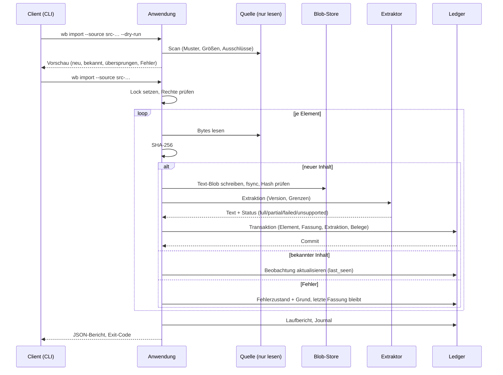

# 04 — Ablagestruktur und Abläufe

Stand: 2026-11-05 · Entwurf · Abläufe; lesender Pilotkern umgesetzt.

## 1. Speicherorte

### 1.1 Store (kanonischer Inhalt)

Standard: `C:\AI-OS-Wissensbasis` (Entscheidung O1). Der Pfad ist konfigurierbar, muss aber außerhalb von Git-Repositories, `%TEMP%`, OneDrive und Netzwerkfreigaben liegen. `wb init` prüft das und bricht sonst ab.

```
<Store>/
  MANIFEST.json                     store_id, schema_version, tool_version, created_at
  locks/store.lock                  Ein-Schreiber-Sperre (PID, Zeit, Host)
  db/
    knowledge.sqlite3               System of Record (WAL)
    knowledge.sqlite3-wal
    knowledge.sqlite3-shm
  blobs/
    sha256/ab/cd/abcdef…            extrahierter Text (unveränderlich)
  index/
    search.sqlite3                  FTS5, jederzeit löschbar
    search.build-<uuid>.sqlite3     Bau-Zwischendatei (nur während des Baus)
    build.json                      letzter Build: ID, Zeit, Quellzählung, Schema
  journal/
    events-2026-11.jsonl            append-only Audit/Recovery-Spiegel
  exports/
    2026-11-05T10-00-00Z/
      manifest.json
      export.jsonl
      blobs/…
  tmp/
    run-<uuid>/                     nur während eines Laufs; garantierte Bereinigung
  state/
    health.json                     letzter Verify, Zähler, letzter Backup, Index-Build
    verify-2026-11-05T…json         Verifikationsbericht
```

**Eigenschaften**

- `db/` ist der kanonische Ledger; `blobs/` enthält ausschließlich **extrahierten Text** (keine Originalbytes). Originale liegen unverändert in ihren Quellen.
- `index/`, `state/` und `exports/` sind Ableitungen; `index/` ist jederzeit löschbar.
- Der Store enthält keine Programme, keine Konfiguration, keine Geheimnisse.
- Dateinamen in `blobs/` sind der Hash; Originalnamen werden nur in Metadaten geführt.
- NTFS-ACL: nur das lokale Benutzerkonto (und Administratoren) liest/schreibt; Vererbung von außen wird entfernt. Sicherungen erben restriktiv.

### 1.1.1 Store-Rollen und lesender Austausch

| Rolle | Wo | Beschreibbar | Zweck |
| --- | --- | --- | --- |
| `leader` | Hauptrechner, `C:\AI-OS-Wissensbasis` | ja | einziger führender Store |
| `mirror` | Zweitrechner, lokal wiederhergestellt | nein (nur Index/State) | Lesen, Suchen, Notizen anzeigen |

- `wb package create` erzeugt einen eingefrorenen Satz: DB-Snapshot, Text-Blobs, Journal, Manifeste und Rechte-Snapshot. Das Paket enthält keine Locators und keine Zugangsdaten.
- `wb restore --readonly` spielt es lokal ein. Der Spiegel verweigert Import, Quellenänderungen, Notizen, Bestätigungen und Originalabruf.
- **Keine aktive SQLite-Datenbank in OneDrive.** Das Paket darf als Archiv in OneDrive liegen; es wird vor Nutzung lokal wiederhergestellt und nie in place geöffnet.

### 1.2 Rechnerkonfiguration (nicht im Store)

```
%LOCALAPPDATA%\AI-OS\Wissensbasis\
  config.json
  logs\wb-20261105.log
  locks\…
```

`config.json` enthält **nur Rechnerbezogenes**:

```json
{
  "schema": "wb/config/v1",
  "store_root": "C:\\AI-OS-Wissensbasis",
  "computer_id": "pc-1f2e…",
  "bindings": [
    {
      "source_id": "src-consulting-zp-sources",
      "binding_key": "bind-zp-sources",
      "kind": "local_path",
      "locator": "C:\\Users\\patri\\AI-OS\\AI-Consulting-OS\\07_ENGAGEMENTS\\active\\ENG-2026-002-ZP-Systemlandschaft\\sources",
      "credential_ref": null
    }
  ],
  "write_back": false,
  "default_space": null
}
```

- **Pfade und Zugangsdaten bleiben lokal.** Der Store speichert nur `locator_fingerprint = sha256(locator)`, damit Konfiguration und Store zusammenpassen.
- Zugangsdaten liegen ausschließlich im Windows Credential Manager; `credential_ref` ist ein Name, kein Wert.
- Exportpakete enthalten keine Locators und keine Credential-Referenzen.

### 1.3 Code und Werkzeuge (Repository, nicht Store)

```
shared/tools/wissensbasis/
  wb/                    Python-Paket (Standardbibliothek)
    __main__.py          CLI
    app.py               Anwendungsschicht, Locking, Transaktionen
    sources.py           Quellenregister, Bindungen, Probe
    importer.py          Scan, Hash, Erfassung, Wiederaufnahme
    extract/             Extraktoren (md, text, html, csv/json intern; pdf/office/eml optional über Adapter)
    extract_adapter.py   Aufruf der isolierten Extraktor-Laufzeit (JSON über stdin/stdout, Zeitlimit)
    ledger.py            Elemente, Fassungen, Belege, Herkunft
    review.py            Bestätigungen
    acl.py               Räume, Vertraulichkeit, Grants, Recheck
    indexer.py           FTS5-Aufbau, Suche
    ops.py               verify, backup, restore, gc, export
    config.py            lokale Konfiguration, Credential-Referenzen
  schema/                SQL-Migrationen (001_init.sql, …)
  tests/                 synthetische Tests, Fixtures
  README.md
```

- Kein Paketmanager-Zwang; `wb` läuft mit dem System-Python (3.10+).
- Keine Daten, keine Logs, keine Exporte im Repository.
- Die Entwurfsdokumente liegen unter `shared/wissensbasis/` und enthalten keine Inhalte.

### 1.4 Pilotarbeitsverzeichnis (separat, außerhalb des Stores)

```
C:\AI-OS-Pilot\
  fixtures\              synthetische Dateien für Änderungs-/Fehlertests
  expected\              Golddateien für Suche und Zähler
  reports\               Pilotberichte (Zahlen, keine Inhalte)
```

Das Pilotverzeichnis ist kein Store und kein Repository. Es wird nach der Abnahme gelöscht oder ausdrücklich aufbewahrt.

## 2. Zustände

### 2.1 Quelle

```
active ──► paused ──► active
   │                     │
   └──► retired ◄────────┘
```

Bindungszustand je Rechner: `reachable`, `unreachable`, `unknown`, `partial`. Ein nicht erreichbarer Pfad macht den Import nicht kaputt; er wird als `unreachable` mit letztem Erfolg gemeldet.

### 2.2 Element und Fassung

```
current   = letzte Fassung, Quelle erreichbar, Extraktion vollständig
stale     = neuere Quelle erkannt, noch nicht importiert
missing   = Quelle meldet Element nicht mehr (Tombstone)
error     = Import/Extraktion fehlgeschlagen, letzter Stand bleibt
```

### 2.3 Auftrag (Job)

```
queued ──► running ──► completed
                └────► failed
                └────► cancelled
```

Ein abgebrochener Lauf hinterlässt keine halben Fassungen (Transaktion je Element) und keine dauerhaften Temporaerdateien (`finally`-Bereinigung, `gc` für Abstürze).

## 3. Importablauf

### 3.1 Vorbedingungen

- Store initialisiert, Quelle registriert, Bindung in der lokalen Konfiguration vorhanden.
- Leserecht auf Quelle und Bindung (`read=1`).
- Kein anderer Schreiber (Lock).
- Ausreichend Speicher; Vorabprüfung der geschätzten Größe.

### 3.2 Ablauf



### 3.3 Regeln

1. **Nur lesen.** Der Import öffnet Quelldateien ausschließlich lesend und schreibt ausschließlich in den Store. Originalbytes werden nicht kopiert (`original_stored=0`).
2. **Idempotenz.** Identischer Inhalt erzeugt keine zweite Fassung; nur `last_seen_at` und ein Beobachtungsereignis.
3. **Transaktion je Element.** Text-Blob vor Commit; ein Absturz hinterlässt höchstens einen verwaisten Text-Blob, nie eine halbe Fassung.
4. **Wiederaufnahme.** Ein erneuter Lauf prüft Hashes und ergänzt fehlende Elemente; bereits bestätigte Fassungen werden nicht neu geschrieben.
5. **Ausschlüsse.** Technische Verzeichnisse (`.git`, `node_modules`, `.venv`, `__pycache__`, `dist`, `build`), Temporaerdateien, symbolische Verweise/Junctions, Dateien über der Größengrenze und Zugangsdatenkandidaten (`.env`, `credentials*`, `*.pem`, `*.key`) werden nicht gelesen, aber mit Grund gemeldet.
6. **Grenzen.** Standard: maximal 200 MB je Datei, maximal 50 000 Elemente je Quelle, 120 s Extraktionszeit je Datei; alle Grenzen sind konfigurierbar und im Bericht genannt. PDF/Office/OCR laufen nur über die optionale, isolierte Extraktor-Laufzeit; fehlt sie, bleibt der Status `unsupported` mit Grund.
7. **Keine KI.** Extraktion ist deterministisch; keine Modelle, keine Netzwerkzugriffe.
8. **Zugriff.** Vor jedem Element wird der tatsächliche Lesezugriff geprüft; ein verweigertes Recht erscheint als übersprungenes Element mit Grund, nie als Erfolg.
9. **Bericht.** `scanned`, `new_items`, `new_versions`, `unchanged`, `failed`, `skipped`, `elapsed`, `errors[]` mit Grund; Exit-Code 0 nur ohne Fehler (Warnungen erlaubt).

### 3.4 Fehler und Wiederaufnahme

| Fall | Verhalten |
| --- | --- |
| Datei verschwindet während des Laufs | Element `error` mit Grund; kein Abbruch des Laufs |
| Datei gesperrt | Element `error`, Wiederholung beim nächsten Lauf |
| Extraktion schlägt fehl | Fassung wird erfasst, Extraktion `failed`; Textsuche findet sie nicht |
| Datenträger voll | Lauf bricht ab, letzte Transaktion rollt zurück, `disk_full` |
| Prozessabbruch | Lock bleibt ggf. verwaist; `wb` erkennt tote PID, `--force-unlock` nur ausdrücklich |
| Beschädigter Blob nach Absturz | `verify` meldet; Element wird gesperrt, bis neu importiert |

## 4. Aktualisierungsablauf

Auslöser: `wb import --source <id>` (manuell oder später geplant). Es gibt keinen Hintergrunddienst im Kern.

1. Scan der Quelle; Vergleich `external_id` und Hash.
2. Neuer Hash → neue Fassung (`seq_no+1`, `supersedes_version_id`), neue Extraktion.
3. Abhängige Wissensfassungen: `needs_recheck`-Ereignis; bestehende Bestätigungen werden `confirmation_stale` (nur wenn die abgelöste Fassung in ihrer Basis lag).
4. `acl recheck` wird angestoßen, wenn Quelle/Bindung/Rechte betroffen sind.
5. Index wird inkrementell ergänzt (oder beim nächsten `index rebuild`).
6. Bericht nennt neue Fassungen, überholte Bestätigungen und betroffene Ableitungen.

**Nicht automatisch:** Ableitungen werden nicht neu geschrieben, Bestätigungen nicht übertragen, Zusammenfassungen nicht aktualisiert.

## 5. Wissens- und Bestätigungsablauf

### 5.1 Notiz anlegen (W1, umgesetzt)

1. `python -m wb note add --title "…" --file body.md --space business`
2. Kern prüft: Raum/Vertraulichkeit gültig, Autor berechtigt, Body lesbar.
3. Schreibt `knowledge`, `knowledge_version` und ein Ereignis; `review_state=unverified`, Lebenszyklus `draft`.
4. Eine Notiz hat keine Belege und ist damit nicht „belegt“; sie kann bestätigt werden, bleibt aber ohne Quellenkette.

**Nicht umgesetzt und ausdrücklich später offen:** Wissensverdichtung (Claims, Zusammenfassungen, Entscheidungen), automatische Ableitungen, Belegpflichtprüfung für generierte Aussagen.

### 5.2 Bearbeiten

Neue Fassung mit `supersedes_version_id`; alte Fassung bleibt abrufbar. `review_state` startet neu. Im Pilotkern ist nur das Anlegen von Notizen umgesetzt, kein Bearbeiten.

### 5.3 Bestätigen (umgesetzt)

1. Client zeigt Fassung, Basis und `basis_hash` an.
2. `python -m wb review confirm <knv-id> [--basis-hash …] --note "…"`.
3. Kern prüft `review`-Recht, gleicht den Basis-Hash ab (Konflikt bei Abweichung), schreibt `review` + Ereignis, setzt `review_state=confirmed` und Lebenszyklus `active`.
4. Neue Belegfassung → `confirmation_stale`; erneute Bestätigung nötig.
5. Ablehnung (`review reject`) ist umgesetzt; Rückzug/Deprecation ist im Modell vorhanden, aber noch ohne CLI.

### 5.4 Veröffentlichen (Pilot: deaktiviert)

`wb publish` ist **nicht implementiert**. Vorgesehen: bestätigte Fassung mit Frontmatter (`knowledge_id`, `version`, `basis_hash`, `review_state`, `source_ids`) in ein Repository schreiben, nur mit `export`-Recht und ausdrücklicher Bestätigung. Kein Überschreiben abweichender Inhalte.

## 6. Schreibabläufe

| Modus | Umfang | Status |
| --- | --- | --- |
| **W0** | Nur lesen; Wissen entsteht ausschließlich durch Import und manuelle Store-Notizen | Standard und einziger Modus im Pilot |
| **W1** | Wissensnotizen im Store anlegen | Notiz-Anlegen umgesetzt; Bearbeiten offen |
| **W2** | Zurückschreiben in eine Quelle | spezifiziert, **nicht implementiert** (`write_back=false`) |

### 6.1 W2-Protokoll (erst nach eigener Freigabe)

Vorbedingungen: Quelle und Bindung `write=1`, `write_back=true`, Grant `write`, Textformat, kein symbolischer Verweis, kein Zugangsdatenkandidat, Datei ≤ 2 MB, Einzeldatei-Aufruf.

1. **Konfliktprüfung:** erwartete Basis muss der aktuellen Fassung entsprechen (`--expect-version`). Sonst Exit 6.
2. **Pre-Image:** aktueller Blob ist bereits gespeichert; zusätzlich wird ein Sicherungskopie-Hinweis im Journal vermerkt.
3. **Temporär schreiben:** Datei im selben Verzeichnis (gleiches Volume), UTF-8/LF, `fsync`.
4. **Atomar ersetzen:** Rename über die Originaldatei; ACL der Originaldatei bleibt erhalten.
5. **Nachprüfung:** Hash der neuen Datei lesen, neue Fassung erfassen, Ereignis `source.written` mit `before_version`, `after_version`, Akteur.
6. **Rücknahme:** `wb write rollback <version>` stellt den vorherigen Blob innerhalb von 10 Minuten wieder her (nur wenn keine weitere Änderung erfolgte).
7. **Verboten:** Löschen, Umbenennen, Massenänderungen, Binärformate, Dateien in `.git`, Quellen ohne Schreibfreigabe.

Im Pilot wird W2 nicht implementiert; die Spezifikation dient der späteren Entscheidung.

## 7. Suchindex: Bau, Wiederherstellung, Suche

### 7.1 Bau

1. `python -m wb index rebuild`
2. Liest alle aktuellen Extraktionen (`status in (full, partial)`) und Wissensfassungen aus dem Ledger.
3. Zerlegt Text in Abschnitte: 1 200 Zeichen, 200 Zeichen Überlappung, Abschnittsüberschrift falls vorhanden (Markdown).
4. Baut `search.build-<uuid>.sqlite3` mit FTS5 (`unicode61`), Tabellen `chunk` und `knowledge_chunk`, `index_meta`.
5. Prüft Zählungen gegen das Ledger, schreibt `build.json`, ersetzt `search.sqlite3` atomar, behält eine Vorgängerversion.

### 7.2 Wiederherstellung

- Index fehlt/beschädigt → `search.sqlite3` löschen (oder umbenennen) und `python -m wb index rebuild`; das ist ein regulärer Vorgang.
- Kein Datenverlust, weil der Index ausschließlich aus Ledger + Text-Blobs entsteht.
- `python -m wb index status` nennt Build-ID und Zählungen; `python -m wb verify` prüft die referenzierten Text-Blobs.

### 7.3 Suche

- Standard: alle Suchwörter müssen vorkommen (`AND`), `--any` erlaubt ODER-Suche.
- Ranking: BM25; deterministische Sortierung bei Gleichstand (ID).
- Jeder Belegtreffer enthält: `source_id`, `source_name`, `item_id`, `version_id`, `space`, `confidentiality`, `heading`, Auszug und Zeichenstelle. Notizen liefern `knowledge_id`, `review_state` und `access_basis`.
- Auszüge stammen wörtlich aus dem Text; sie werden nicht umformuliert.
- Keine Treffer ohne Beleg; keine generierten Antworten im Pilot.
- Rechtefilter wird vor der Ausgabe angewendet (nicht nachträglich im Client). Verweigerte Quellen werden gezählt (`filtered_by_access`), nicht stillschweigend ausgelassen.

## 8. Sicherung, Prüfung, Wiederherstellung

### 8.1 Sicherung

- `python -m wb backup --out <ziel>` erzeugt unter dem Store-Lock einen konsistenten Snapshot über die SQLite-Backup-API, kopiert die Text-Blobs und das Journal, prüft jede Blob-Prüfsumme und schreibt `backup.json` mit Hashes und Zählungen.
- **Originale werden nicht gesichert** (sie liegen nicht im Store); für sie gilt [06_SICHERUNG.md](06_SICHERUNG.md).
- Der Index wird nicht gesichert; er ist reproduzierbar.
- Aufbewahrungsrotation ist im Pilot **manuell**; die Zahlen (14/8/12) sind Vorgabe, nicht automatisch erzwungen.
- Ein Store auf einem anderen Datenträger ist erst nach `restore` + `verify --full` gültig.

### 8.2 Prüfung

`python -m wb verify [--access]`:

- SQLite-Integrität, Fremdschlüssel, Schema-Version.
- Genau eine aktuelle Extraktion je Fassung, lückenlose Fassungsnummern und Vorgängerkette.
- Jede referenzierte Text-Blob-Datei: Existenz, Größe, SHA-256; unreferenzierte Dateien als Warnung.
- Bestätigungsbasis gegen den gespeicherten Basis-Hash.
- Aktuelle Wissensfassungen und Belegpflicht für belegpflichtige Arten.
- Konfigurations-Fingerprints der Bindungen.
- Journal-Spiegelung (Warnung bei Abweichung).
- Mit `--access`: aktueller Quellenzugriff (nur als Prüfung, ohne Schreibzugriff).
- Ergebnisbericht in `state/verify-<zeit>.json`; Exit 5 bei Fehlern.

### 8.3 Wiederherstellung

- `python -m wb restore --from <backup> --root <neu>`: Backup enthält DB, Text-Blobs und Journal. `restore` prüft DB-Hash und jede Blob-Prüfsumme, legt den Store an, prüft die Integrität und baut den Index neu.
- `python -m wb restore --from <paket> --root <neu> --readonly` erzeugt einen Spiegelstore (Rolle `mirror`).
- Ohne `--no-index` wird der Index nach der Wiederherstellung neu gebaut.

### 8.4 Betriebsrhythmus

| Rhythmus | Aufgabe |
| --- | --- |
| Nach jeder Quellenänderung | `python -m wb import --source …` und Bericht prüfen |
| Täglich | `python -m wb backup --out …` |
| Wöchentlich | `python -m wb verify --access` |
| Monatlich | Wiederherstellungstest in einem temporären Store |
| Nach Werkzeugupdate | Migration, `verify`, `index rebuild` |
| Nach Rechteänderung | `python -m wb acl recheck` und betroffene Bestätigungen prüfen |

## 9. Rechte-Neuberechnung

`python -m wb acl recheck`:

1. Prüft für jede aktive Quelle den konfigurierten und den tatsächlichen Zugriff (`os.access`) und protokolliert das Ergebnis in `access_check`.
2. Aktualisiert `observed_read`/`state` der Bindung; Abweichungen werden als `mismatch` berichtet.
3. Für abgeleitetes Wissen (noch nicht umgesetzt) wird die Schnittmenge über alle Belege neu bewertet und `needs_review` gesetzt, wenn sich Raum/Vertraulichkeit verschärfen.
4. Grants werden nicht stillschweigend erweitert; eine Verweigerung sperrt die betroffenen Inhalte für die Ausgabe.

## 10. Temporaerdateien und Bereinigung

- Jeder Lauf erhält `tmp/run-<uuid>/`; am Ende wird das Verzeichnis gelöscht (auch im Fehlerfall).
- Abstürze hinterlassen möglicherweise Verzeichnisse; `wb gc` entfernt sie nach 24 Stunden.
- `wb gc` entfernt außerdem Blobs ohne Referenz, die älter als 7 Tage sind, und verwaiste Lock-Dateien.
- `tmp/` und `exports/` werden nie indexiert.

## 11. Protokollierung

- `journal/events-*.jsonl`: jede schreibende Operation, ohne Inhalte.
- `logs/wb-YYYYMMDD.log`: Laufzeiten, Zähler, Fehlercodes, Pfade relativ zur Quelle; keine Dokumenttexte, keine Empfängerlisten, keine Tokens.
- `state/health.json`: letzter erfolgreicher Verify, Backup, Index-Build, offene Fehler, Zähler.
- Keine Telemetrie, keine Netzwerkaufrufe.

## 12. Betriebsbefehle (implementiert)

| Befehl | Zweck |
| --- | --- |
| `python -m wb init --root …` | Store anlegen, Manifest/Schema/Rechte prüfen |
| `python -m wb source add` / `list` / `probe` | Quelle registrieren, Herkunft/Rechte pflegen, tatsächlichen Zugriff prüfen |
| `python -m wb import --source … [--dry-run]` | Import/Aktualisierung, optional Index-Neubau; PDF nur mit `--formats pdf` |
| `python -m wb ocr <version-id>` | OCR ausstehender PDF-Seiten als eigener Schritt, danach Index-Neubau |
| `python -m wb item list` / `show` | Elemente, Fassungen und Herkunft anzeigen |
| `python -m wb original <id> --out …` | Original lesend und hashgeprüft abrufen |
| `python -m wb search "…"` | Belegte lexikalische Treffer |
| `python -m wb note add` / `list` / `show` | Store-Notizen (W1) |
| `python -m wb review confirm|reject|status` | Manuelle Bestätigung |
| `python -m wb acl check` / `recheck` | Konfiguriertes und tatsächliches Recht prüfen |
| `python -m wb index rebuild` / `status` | Suchindex neu bauen / Status |
| `python -m wb verify [--access]` | Integrität prüfen, Exit 5 bei Fehlern |
| `python -m wb backup --out …` / `restore --from … --root …` | Konsistent sichern und wiederherstellen |
| `python -m wb package create --out …` | Schreibgeschütztes Austauschpaket |
| `python -m wb gc` | Temporaerdateien und verwaiste Text-Blobs entfernen |
| `python -m wb status` / `doctor` | Übersicht / Pfad- und Zustandsprüfung |

Nicht implementiert: `publish`, `export` (durch `package` abgedeckt), W2. Wissensinhalte der Arten `claim`/`summary`/`decision`/`register_entry` können mit `knowledge add` belegt angelegt werden; es gibt aber keine automatische Verdichtung.

Alle Befehle unterstützen `--json` (`schema: wb/v1`) und, wo sinnvoll, `--dry-run`.

## 13. Fehlerfälle im Betrieb

| Fall | Erkennung | Reaktion |
| --- | --- | --- |
| Store liegt in OneDrive | `wb init`/`wb doctor` | Abbruch mit Pfadhinweis |
| Falsche Store-Version | `schema_migrations` | Abbruch; Migration nur mit `wb migrate` |
| Manifest fehlt/abweichend | `wb doctor` | Store als `unknown` behandeln, kein Schreiben |
| Index veraltet | `index/build.json` vs. Ledger-Zähler | `index status` meldet Abweichung; Rebuild ausführen |
| Doppelter Schreiber | Lock | Warten oder klare Meldung, kein Force ohne Bestätigung |
| DB beschädigt | `integrity_check` schlägt fehl | Letzten Snapshot einspielen; Journal für Nachvollziehbarkeit |
| Text-Blob fehlt/beschädigt | `verify` | Fehler melden; Element bleibt lesbar nur ohne Text, Quelle neu importieren |
| Rechte geändert | `acl recheck` | Bindung/Quelle sperren, Bericht; Ableitungen folgen später |
| Speicherplatz knapp | Vorabprüfung, Schreibfehler | Sauberer Abbruch, keine halbe Fassung |
| Store in OneDrive | `init`/`doctor` | Abbruch; Paket als Archiv verwenden und lokal wiederherstellen |

## 14. Was der Pilot nicht ausführt

- Kein Import der 12 600 Bestandsdateien, kein Mail-Import, kein PST.
- Keine Schreibvorgänge in Quellen (W2).
- Kein Veröffentlichen in Repositories.
- Keine automatische OCR beim Import, keine Anhangs-Extraktion, keine KI-Ableitung. OCR läuft nur ausdrücklich über `wb ocr`.
- **Keine semantische Suche und keine Wissensverdichtung.** Beides ist ausdrücklich später und offen; es gibt keine Embeddings, keine Vektordatenbank, keine generierten Zusammenfassungen oder Claims.
- Keine Änderung an Themenlandkarte, Repositories oder Originalen.
- Keine aktive SQLite-Datenbank in OneDrive.
